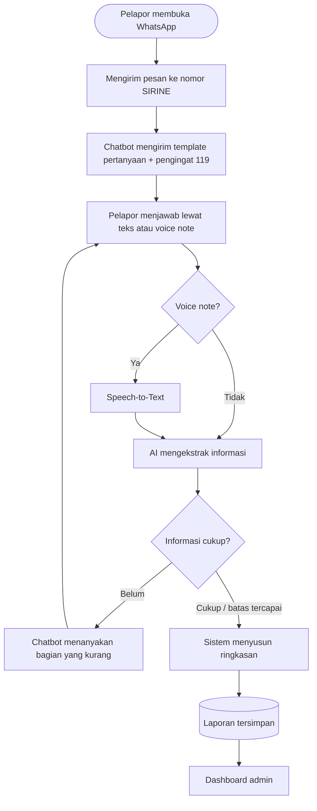
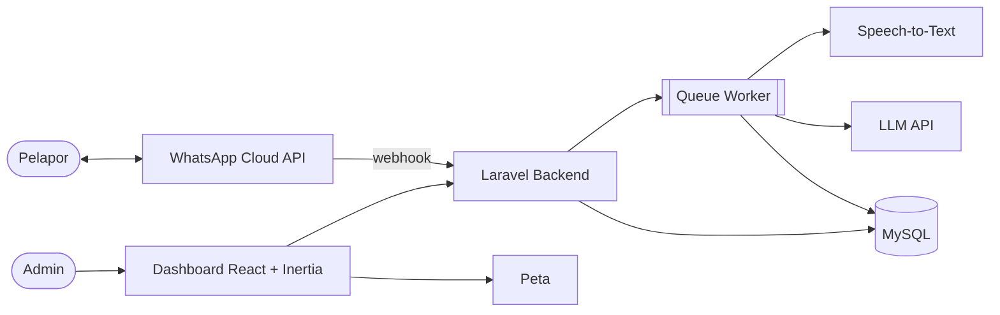

# SIRINE
### Sistem Informasi Respons Insiden dan Notifikasi Emergency

> **Tagline:** Satu Peringatan, Awal Sebuah Penanganan.
> **Filosofi:** Sirene menjadi simbol peringatan yang mengingatkan pentingnya respons saat terjadi keadaan darurat.
> **Posisi:** Pelengkap layanan darurat 119, bukan pengganti.

---

## 1. Ringkasan Eksekutif

Saat terjadi kecelakaan atau kejadian darurat, orang yang melapor sering panik. Informasi yang disampaikan pun tidak lengkap, tidak berurutan, atau tidak jelas lokasinya. Akibatnya, pihak yang menerima laporan harus bertanya berulang kali untuk memahami situasi.

**SIRINE** adalah asisten pelaporan di WhatsApp yang membantu masyarakat menyampaikan kejadian secara terstruktur. Pelapor cukup bercerita lewat teks atau voice note. Sistem lalu:

1. mengubah suara menjadi teks (jika voice note),
2. mengekstrak informasi penting dengan AI,
3. memeriksa bagian yang masih kurang atau kabur,
4. menanyakan hanya bagian tersebut, bukan seluruh pertanyaan dari awal,
5. menyusun ringkasan laporan yang rapi dan menyimpannya ke dashboard untuk ditinjau.

Pelapor tidak perlu memasang aplikasi baru. Cukup memakai WhatsApp yang sudah ada di ponselnya.

---

## 2. Latar Belakang

Dalam situasi darurat, kemampuan seseorang menyusun informasi menurun. Pelapor mungkin hanya mengatakan "ada kecelakaan" tanpa menyebut lokasi, waktu, jumlah korban, atau kondisi di lapangan. Informasi seperti itu sulit dicatat dan membutuhkan banyak tanya-jawab.

Di sisi lain, WhatsApp sudah menjadi aplikasi yang akrab bagi sebagian besar masyarakat Indonesia. Fitur seperti voice note dan Share Location sudah biasa dipakai, sehingga bisa dimanfaatkan sebagai jalur pelaporan yang tidak memerlukan pembelajaran baru.

SIRINE memanfaatkan dua hal tersebut: kebiasaan masyarakat memakai WhatsApp, dan kemampuan AI untuk memahami bahasa sehari-hari serta menemukan informasi yang belum lengkap.

---

## 3. Masalah yang Diselesaikan

| # | Masalah | Dampak |
|---|---|---|
| 1 | Pelapor panik dan sulit menyampaikan informasi secara lengkap | Laporan tidak utuh |
| 2 | Lokasi, waktu, kronologi, dan kondisi korban sering terlewat | Petugas harus bertanya ulang |
| 3 | Pelapor tidak tahu informasi apa yang perlu disampaikan | Informasi penting tidak tersampaikan |
| 4 | Pesan suara dan teks bebas tidak terstruktur | Harus diolah manual sebelum dipakai |
| 5 | Informasi dari masyarakat perlu dirangkum | Sulit dibaca cepat dan ditinjau |

---

## 4. Solusi dan Nilai Pembeda

### 4.1 Gambaran solusi
Chatbot WhatsApp yang menuntun pelapor dengan template pertanyaan di awal. Jawaban dianalisis AI dan dipetakan ke bagian-bagian laporan. Bila ada yang belum jelas, chatbot bertanya secara spesifik. Hasil akhirnya ringkasan terstruktur yang bisa ditinjau admin di dashboard.

### 4.2 Yang membedakan dari chatbot biasa

| Chatbot biasa | SIRINE |
|---|---|
| Menerima pesan lalu membalas | Memeriksa kelengkapan informasi |
| Pertanyaan tetap dan berulang | Hanya menanyakan bagian yang kurang |
| Teks saja | Teks dan voice note |
| Menyimpan percakapan mentah | Menghasilkan laporan terstruktur dan ringkasan |
| Bisa mengarang jawaban | Dilarang mengarang, informasi tak disebut ditandai "belum diketahui" |

### 4.3 Prinsip rancangan
1. **Tidak menghambat pertolongan.** Setiap awal percakapan mengingatkan pelapor menghubungi 119 jika butuh pertolongan segera.
2. **Tidak mengarang.** AI hanya memasukkan informasi yang benar-benar disebut pelapor.
3. **Tidak memaksa.** Pelapor boleh menjawab "tidak tahu" dan laporan tetap tersimpan.
4. **Pesan asli tetap dipertahankan.** Teks asli dan transkrip disimpan berdampingan dengan hasil olahan AI.
5. **Manusia yang menentukan.** Kebenaran kejadian dinilai oleh admin atau pihak berwenang, bukan oleh AI.

---

## 5. Tujuan

**Tujuan umum:** Mempermudah masyarakat menyampaikan informasi kejadian secara lengkap dan terstruktur melalui WhatsApp.

**Tujuan khusus:**
1. Menyediakan jalur pelaporan lewat WhatsApp, baik teks maupun voice note.
2. Membantu pelapor lewat template pertanyaan di awal.
3. Memanfaatkan AI untuk memeriksa kelengkapan dan membuat pertanyaan lanjutan.
4. Mengubah laporan teks dan suara menjadi laporan terstruktur.
5. Menyediakan dashboard untuk melihat, membaca, dan mengelola laporan.

---

## 6. Pengguna dan Pemangku Kepentingan

| Pihak | Peran | Kebutuhan |
|---|---|---|
| **Pelapor** (masyarakat) | Mengirim informasi kejadian | Cara melapor yang mudah, cepat, dan tidak membingungkan |
| **Admin dashboard** | Meninjau dan mengelola laporan | Laporan yang rapi, lengkap, dan jelas sumbernya |
| **Chatbot dan AI** | Memandu dan mengolah informasi | Aturan yang jelas agar tidak mengarang |
| **Layanan darurat** (calon mitra) | Menerima informasi yang lebih tertata | Integrasi hanya jika ada kerja sama resmi |

Admin adalah pengelola dashboard SIRINE. Admin bukan otomatis petugas rumah sakit, Damkar, atau operator resmi 119.

---

## 7. Cakupan dan Batasan

### Di dalam cakupan
- Penerimaan pesan teks dan voice note lewat WhatsApp.
- Template pertanyaan dan pertanyaan lanjutan otomatis.
- Transkripsi suara.
- Ekstraksi informasi dan pemeriksaan kelengkapan oleh AI.
- Penerimaan lokasi dari Share Location.
- Ringkasan laporan.
- Dashboard admin: daftar, detail, status, dan peta.

### Di luar cakupan (batasan)
1. Bukan layanan tanggap darurat mandiri dan tidak menggantikan 119.
2. Tidak mengirim ambulans atau petugas secara otomatis.
3. Tidak menentukan kebenaran kejadian hanya berdasarkan AI.
4. Tidak mendiagnosis atau menilai keparahan medis.
5. Tidak mewajibkan foto atau video korban.
6. Tidak mengasumsikan integrasi langsung dengan 119. Integrasi resmi hanya jika ada kerja sama dan akses yang sesuai.
7. Laporan yang belum lengkap tetap dapat disimpan sebagai laporan sementara.

---

## 8. Cara Kerja

### 8.1 Alur dari sudut pandang pelapor

### 8.2 Contoh percakapan

> **Chatbot:** Halo, selamat datang di SIRINE. Silakan sampaikan jenis kejadian, waktu, lokasi, kronologi singkat, dan kondisi korban jika ada. Jika butuh pertolongan darurat, segera hubungi 119.
>
> **Pelapor (voice note, setelah ditranskripsi):** "Ada kecelakaan di Jalan Merdeka sekitar jam delapan malam, dua motor tabrakan, satu orang jatuh dan kelihatan luka."
>
> **Chatbot:** Terima kasih. Apakah jumlah keseluruhan korban diketahui?
>
> **Pelapor:** Saya cuma lihat satu orang, nggak tahu yang lain.
>
> **Chatbot:** Baik, dicatat: satu orang terlihat terjatuh, jumlah keseluruhan belum diketahui. Apakah ada patokan lokasi yang lebih spesifik?
>
> **Pelapor:** Dekat persimpangan Jalan Merdeka dan Jalan Ahmad Yani.

**Hasil laporan terstruktur:**

| Informasi | Nilai | Status |
|---|---|---|
| Jenis kejadian | Kecelakaan lalu lintas | Diketahui |
| Waktu | Sekitar pukul 20.00 | Diketahui |
| Lokasi | Persimpangan Jl. Merdeka dan Jl. Ahmad Yani | Diketahui |
| Kronologi | Dua sepeda motor bertabrakan | Diketahui |
| Jumlah korban | Belum diketahui (satu orang terlihat terjatuh) | Belum diketahui |
| Kondisi korban | Satu orang terlihat terluka | Diketahui (berdasarkan keterangan pelapor) |

---

## 9. Fitur

### 9.1 Sisi WhatsApp (pelapor)
| Fitur | Deskripsi | Prioritas |
|---|---|---|
| Template pertanyaan | Panduan informasi yang perlu disampaikan | 1 |
| Laporan via teks | Jawaban bebas dalam satu pesan | 1 |
| Pertanyaan lanjutan | Hanya menanyakan bagian yang kurang atau kabur | 1 |
| Ringkasan laporan | Pelapor menerima rangkuman dan dapat mengoreksi | 1 |
| Laporan via voice note | Suara diubah menjadi teks | 2 |
| Share Location | Koordinat kejadian lewat fitur WhatsApp | 2 |

### 9.2 Pemrosesan AI
| Fitur | Deskripsi |
|---|---|
| Ekstraksi informasi | Memetakan jawaban ke jenis kejadian, waktu, lokasi, kronologi, korban |
| Penandaan status informasi | Setiap bagian ditandai *diketahui*, *belum diketahui*, atau *ambigu* |
| Deteksi pertentangan | Informasi yang saling bertentangan ditanyakan ulang |
| Pembuatan ringkasan | Merangkum laporan dengan bahasa jelas dan netral |

### 9.3 Dashboard admin
| Fitur | Deskripsi | Prioritas |
|---|---|---|
| Login admin | Akses hanya untuk akun terdaftar | 1 |
| Statistik ringkas | Total, baru, belum lengkap, siap ditinjau, dalam pemeriksaan | 1 |
| Daftar laporan | Dengan filter status, tanggal, dan jenis kejadian | 1 |
| Detail laporan | Pesan asli, audio, transkrip, ringkasan, riwayat percakapan | 1 |
| Ubah status | Disertai catatan dan riwayat perubahan | 1 |
| Peta lokasi | Titik kejadian bila koordinat tersedia | 2 |

---

## 10. Status Laporan dan Validasi

**Validasi informasi** memeriksa apakah laporan lengkap dan konsisten. **Verifikasi kejadian** memastikan kejadian benar-benar terjadi oleh pihak berwenang. SIRINE berfokus pada validasi kelengkapan, bukan verifikasi kebenaran.

| Status | Arti |
|---|---|
| Baru diterima | Pesan berhasil diterima |
| Menunggu informasi | Informasi utama belum lengkap |
| Siap ditinjau | Informasi yang diperlukan sudah terkumpul |
| Dalam pemeriksaan | Admin sedang meninjau |
| Belum terkonfirmasi | Kebenaran belum dapat dipastikan |
| Terverifikasi | Dikonfirmasi lewat proses yang sesuai |
| Tidak valid | Ada alasan kuat laporan tidak benar |

Laporan yang belum lengkap atau belum terkonfirmasi **tidak boleh** otomatis dianggap palsu atau dihapus.

---

## 11. Arsitektur Sistem

| Komponen | Teknologi | Fungsi |
|---|---|---|
| Backend | Laravel | Webhook, logika percakapan, API |
| Frontend | React + Inertia.js | Dashboard admin |
| Database | MySQL | Pelapor, percakapan, pesan, laporan, riwayat |
| Pesan | WhatsApp Cloud API | Menerima dan mengirim pesan |
| Suara | Layanan Speech-to-Text | Transkripsi voice note |
| AI | LLM API | Ekstraksi informasi, pertanyaan lanjutan, ringkasan |
| Peta | Leaflet + OpenStreetMap | Menampilkan lokasi |
| Antrean | Laravel Queue | Pemrosesan di belakang layar agar webhook cepat dan pesan tidak hilang |

**Keandalan:** setiap pesan dicatat lebih dulu sebelum diproses. Bila layanan AI atau STT gagal, pesan tetap tersimpan dan dapat diproses ulang. Pesan yang sama tidak diproses dua kali.

---

## 12. Rancangan Data (ringkas)

| Tabel | Fungsi |
|---|---|
| `admins` | Akun pengelola dashboard |
| `reporters` | Nomor WhatsApp pelapor |
| `conversations` | Sesi tanya-jawab dan pertanyaan yang sedang menunggu |
| `messages` | Log pesan masuk dan keluar, termasuk audio dan transkrip |
| `reports` | Laporan terstruktur beserta ringkasan dan status |
| `report_details` | Status tiap bagian informasi (diketahui, belum diketahui, ambigu) |
| `report_histories` | Jejak perubahan status oleh admin |

Diagram ERD lengkap ada di `03-erd-database.md` dan skema SQL di `04-schema.sql`.

---

## 13. Keamanan dan Privasi

| Aspek | Rancangan |
|---|---|
| Data pelapor | Nomor WhatsApp dan identitas hanya dapat diakses pihak berwenang |
| Akses dashboard | Hanya admin terdaftar, password disimpan dalam bentuk hash |
| Rahasia | Token WhatsApp dan kunci API tidak pernah dikirim ke frontend |
| Audio | Disimpan di penyimpanan privat dan hanya dapat diputar lewat akun admin |
| Pemisahan data | Pesan asli dan hasil transkripsi disimpan terpisah |
| Foto korban | Tidak diwajibkan, tidak diminta secara default |
| Jejak audit | Aktivitas penting admin dicatat |
| Penggunaan data | Tidak dipakai untuk kepentingan lain tanpa dasar dan persetujuan yang sesuai |
| Kebijakan retensi | Perlu ditetapkan lama penyimpanan audio dan data sensitif |

---

## 14. Pengujian

Dua belas skenario pengujian (TC-01 sampai TC-12) mencakup laporan teks lengkap dan tidak lengkap, voice note jelas dan tidak jelas, korban tidak diketahui, Share Location, pelapor berhenti merespons, pesan terkirim ulang, informasi bertentangan, kegagalan AI, serta pengelolaan status oleh admin. Daftar dan lembar pelacakannya ada di `06-progress.md`.

---

## 15. Rencana Pengembangan

| Tahap | Isi |
|---|---|
| **MVP (Prioritas 1)** | WhatsApp teks, template, ekstraksi AI, pemeriksaan kelengkapan, pertanyaan lanjutan, penyimpanan, dashboard daftar dan detail |
| **Pendukung (Prioritas 2)** | Voice note, Speech-to-Text, Share Location, peta, riwayat percakapan |
| **Lanjutan (Prioritas 3)** | Deteksi laporan serupa, banyak jenis kejadian, statistik, integrasi resmi dengan layanan darurat bila ada kerja sama |

Untuk demo hackathon, Prioritas 1 harus berjalan lebih dulu. Voice note dan peta ditambahkan bila waktu memungkinkan.

---

## 16. Risiko dan Mitigasi

| Risiko | Mitigasi |
|---|---|
| AI salah menafsirkan atau mengarang | Aturan ketat di prompt, status "belum diketahui", validasi keluaran, pesan asli selalu tersedia |
| Transkripsi suara salah (misalnya nama jalan) | Tampilkan transkrip di dashboard, minta konfirmasi lokasi |
| Laporan palsu atau iseng | Tidak otomatis dipercaya, perlu pemeriksaan admin, status "belum terkonfirmasi" |
| Pelapor terjebak tanya-jawab panjang | Batas jumlah pertanyaan, boleh menjawab "tidak tahu", laporan tetap tersimpan |
| Pelapor mengandalkan chatbot dibanding 119 | Pengingat 119 di awal percakapan, penegasan posisi sebagai pelengkap |
| Gangguan layanan AI/WhatsApp | Pencatatan pesan lebih dulu, antrean dan pemrosesan ulang |
| Kebocoran data sensitif | Akses terbatas, penyimpanan privat, jejak audit |
| Waktu pengerjaan terbatas | Prioritas fitur yang jelas, pembagian tugas paralel |

---

## 17. Indikator Keberhasilan

Angka target ditetapkan setelah uji coba. Indikator yang dapat diukur:

| Indikator | Cara mengukur |
|---|---|
| Kelengkapan laporan | Persentase laporan berstatus lengkap dibanding total |
| Jumlah pertanyaan lanjutan | Rata-rata pertanyaan yang dibutuhkan sampai laporan lengkap |
| Waktu penyusunan laporan | Durasi dari pesan pertama sampai laporan tersimpan |
| Akurasi ekstraksi | Kesesuaian hasil AI dengan pesan asli pada uji skenario |
| Akurasi transkripsi | Kesesuaian transkrip dengan isi voice note pada uji skenario |
| Tingkat selesai | Persentase percakapan yang tidak ditinggalkan di tengah jalan |

---

## 18. Pembagian Tim

| Peran | Tanggung jawab |
|---|---|
| **Dev A: Chatbot dan AI** | Webhook WhatsApp, queue, Speech-to-Text, ekstraksi LLM, pemeriksaan kelengkapan, pertanyaan lanjutan, ringkasan |
| **Dev B: Data dan Dashboard** | Database, autentikasi admin, daftar dan detail laporan, status, riwayat, peta |

Rincian fase dan tugas ada di `01-alur-dan-pembagian-tugas.md`.

---

## 19. Kesimpulan

SIRINE membantu masyarakat menyampaikan kejadian dengan lebih lengkap tanpa perlu memahami format pelaporan. Cukup bercerita lewat WhatsApp, sistem akan menyusunnya dan menanyakan bagian yang kurang. Hasilnya adalah laporan terstruktur yang mudah ditinjau.

Sistem ini sengaja dirancang sebagai pelengkap layanan 119. Prinsip utamanya adalah mempermudah komunikasi, menjaga keakuratan informasi, dan tidak menghambat pelapor mendapatkan pertolongan darurat.
