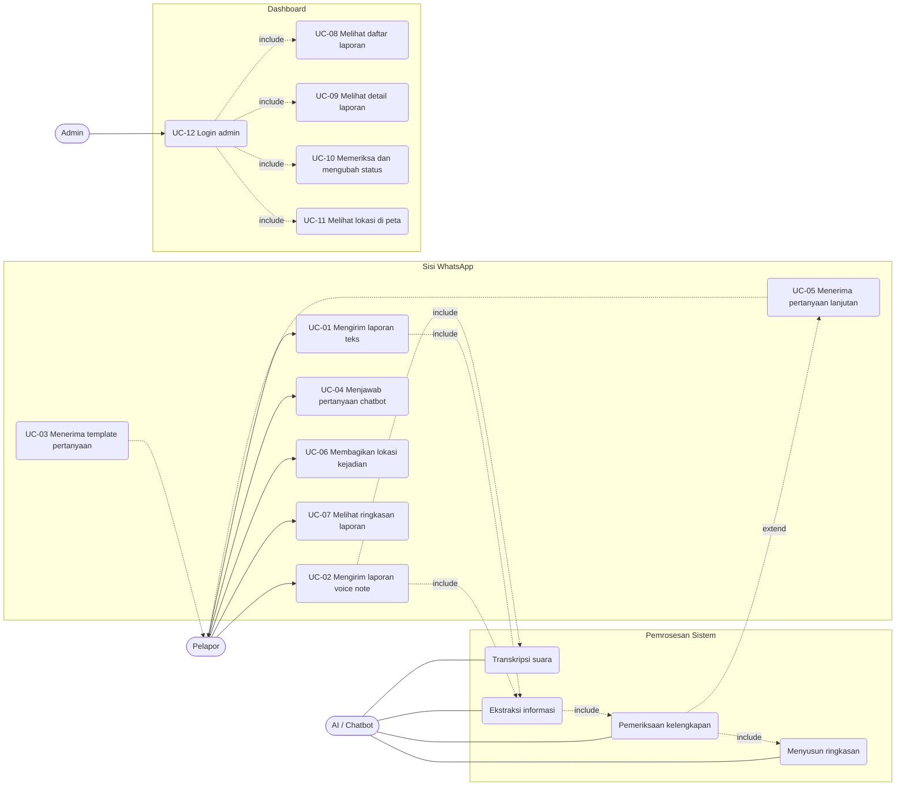

# SuaraTanggap: Use Case

## 1. Diagram use case

## 2. Daftar use case

| ID | Use case | Aktor | Prioritas |
|---|---|---|---|
| UC-01 | Mengirim laporan teks | Pelapor | 1 |
| UC-02 | Mengirim laporan voice note | Pelapor | 2 |
| UC-03 | Menerima template pertanyaan | Pelapor | 1 |
| UC-04 | Menjawab pertanyaan chatbot | Pelapor | 1 |
| UC-05 | Menerima pertanyaan lanjutan | Pelapor | 1 |
| UC-06 | Membagikan lokasi kejadian | Pelapor | 2 |
| UC-07 | Melihat ringkasan laporan | Pelapor | 1 |
| UC-08 | Melihat daftar laporan | Admin | 1 |
| UC-09 | Melihat detail laporan | Admin | 1 |
| UC-10 | Memeriksa dan mengubah status laporan | Admin | 1 |
| UC-11 | Melihat lokasi laporan di peta | Admin | 2 |
| UC-12 | Login admin | Admin | 1 |

> Catatan: dokumen RPL awal memakai penomoran UC yang berbeda di tabel (bagian 8.1) dan di deskripsi (8.2-8.4). Versi di atas menyatukannya dengan penomoran tunggal. Gunakan versi ini di laporan akhir.

## 3. Skenario

### UC-01 / UC-03 / UC-04: Mengirim laporan teks
- **Aktor:** Pelapor
- **Prakondisi:** Pelapor punya WhatsApp dan mengetahui nomor SuaraTanggap.
- **Alur utama:**
  1. Pelapor mengirim pesan pertama ke nomor SuaraTanggap.
  2. Sistem membuat/menemukan data pelapor dan membuka sesi percakapan.
  3. Chatbot mengirim template pertanyaan beserta pengingat untuk menghubungi 119.
  4. Pelapor menjawab dalam satu pesan teks.
  5. Sistem mengekstrak informasi dan menyimpannya sebagai laporan.
- **Alternatif:**
  - 4a. Pelapor tidak menjawab, laporan sementara tetap tersimpan dengan status `incomplete`.
  - 4b. Pesan tidak berisi informasi kejadian, chatbot mengulang pertanyaan inti secara singkat.
- **Pascakondisi:** Laporan tersimpan dengan `completeness_status` dan `report_status` yang sesuai.

### UC-02: Mengirim laporan voice note
- **Aktor:** Pelapor, AI
- **Alur utama:**
  1. Pelapor mengirim voice note.
  2. Webhook menerima pesan bertipe `audio`.
  3. Backend mengunduh media dari Cloud API.
  4. Audio dikirim ke layanan Speech-to-Text.
  5. Transkrip disimpan, lalu diproses seperti pesan teks (UC-01 langkah 5).
- **Alternatif:**
  - 4a. Transkripsi gagal atau tidak jelas, chatbot meminta pelapor mengirim ulang atau mengetik.
  - 4b. Layanan STT down, pesan tetap dicatat dan masuk antrean ulang (TC-12).

### UC-05: Menerima pertanyaan lanjutan
- **Aktor:** Chatbot, AI, Pelapor
- **Alur utama:**
  1. AI menerima jawaban pelapor dan mengekstrak informasi.
  2. Sistem menandai tiap field sebagai `known`, `unknown`, atau `ambiguous`.
  3. Jika ada field wajib `unknown` atau `ambiguous`, chatbot menanyakan satu bagian itu saja.
  4. Pelapor menjawab, sistem memperbarui field.
  5. Ulangi sampai lengkap atau batas pertanyaan tercapai.
- **Alternatif:**
  - 4a. Pelapor menjawab "tidak tahu", field disimpan sebagai `unknown` dan tidak ditanyakan lagi.
  - 4b. Jawaban bertentangan dengan data sebelumnya, chatbot meminta klarifikasi (TC-11).
- **Aturan:** AI tidak boleh mengarang informasi yang tidak disebut pelapor.

### UC-06: Membagikan lokasi
- **Alur utama:** Pelapor mengirim Share Location, sistem menyimpan latitude/longitude, lalu chatbot menanyakan apakah titik itu lokasi kejadian atau lokasi pelapor.
- **Pascakondisi:** `location_source = whatsapp_location`, status konfirmasi lokasi tersimpan.

### UC-07: Melihat ringkasan laporan
- **Alur utama:** Setelah informasi cukup, chatbot mengirim ringkasan ke pelapor. Pelapor boleh mengoreksi.

### UC-08 / UC-09: Melihat daftar dan detail laporan
- **Aktor:** Admin
- **Prakondisi:** Admin sudah login.
- **Alur utama:**
  1. Admin membuka daftar laporan (filter status, tanggal, jenis kejadian).
  2. Admin memilih satu laporan.
  3. Sistem menampilkan pesan asli, audio, transkrip, ringkasan, korban, lokasi dan peta, riwayat percakapan, dan riwayat status.

### UC-10: Memeriksa dan mengubah status
- **Alur utama:**
  1. Admin membuka detail laporan.
  2. Admin memilih status baru dan menulis catatan (opsional).
  3. Sistem menyimpan perubahan ke `reports` dan mencatat baris baru di `report_histories`.
- **Aturan:** Laporan belum lengkap atau belum terkonfirmasi tidak boleh otomatis dihapus atau dianggap palsu.

### UC-11: Melihat lokasi di peta
- **Prakondisi:** Laporan memiliki koordinat.
- **Alur utama:** Admin melihat penanda di peta pada detail laporan atau pada peta gabungan.

### UC-12: Login admin
- **Alur utama:** Admin memasukkan email dan password, sistem memverifikasi hash dan membuka dashboard. Aktivitas penting dicatat.
