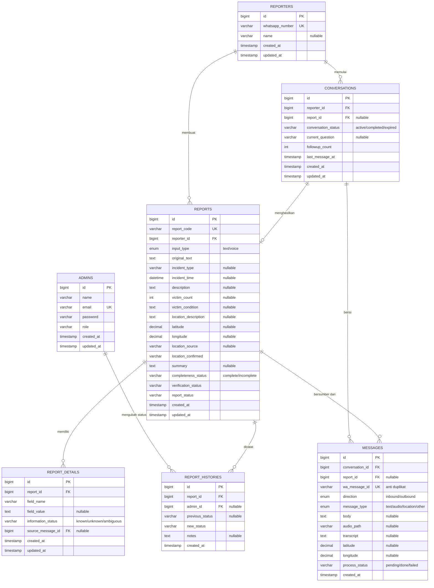

# SuaraTanggap: ERD dan Rancangan Database

Dasar rancangan: dokumen RPL bagian 9, dengan **tiga perbaikan** (dijelaskan di bagian 3).

## 1. ERD

## 2. Kamus data singkat

| Tabel | Fungsi |
|---|---|
| `admins` | Akun pengelola dashboard |
| `reporters` | Satu baris per nomor WhatsApp pelapor |
| `conversations` | Satu sesi tanya-jawab. Menyimpan pertanyaan yang sedang ditunggu jawabannya |
| `messages` | Log semua pesan masuk dan keluar. Kunci anti-duplikat ada di `wa_message_id` |
| `reports` | Laporan terstruktur hasil ekstraksi AI |
| `report_details` | Status per field (`known/unknown/ambiguous`), dipakai untuk memutuskan pertanyaan lanjutan |
| `report_histories` | Jejak perubahan status oleh admin |

### Nilai enum yang disepakati

| Kolom | Nilai |
|---|---|
| `reports.report_status` | `baru_diterima`, `menunggu_informasi`, `siap_ditinjau`, `dalam_pemeriksaan` |
| `reports.verification_status` | `belum_terkonfirmasi`, `terverifikasi`, `tidak_valid` |
| `reports.completeness_status` | `complete`, `incomplete` |
| `reports.location_source` | `text`, `whatsapp_location` |
| `reports.location_confirmed` | `unconfirmed`, `confirmed_incident`, `reporter_location` |
| `conversations.conversation_status` | `active`, `completed`, `expired` |

## 3. Perbaikan dari rancangan RPL

1. **Tambah tabel `messages`.** Di RPL, `whatsapp_message_id` ada di `reports`. Padahal satu laporan terdiri dari beberapa pesan (template, jawaban, pertanyaan lanjutan, voice note). Dengan tabel `messages`, anti-duplikat (TC-08) bisa dijaga per pesan, riwayat percakapan (halaman detail) tinggal diambil dari tabel ini, dan pesan yang gagal diproses AI bisa diulang (TC-12) lewat `process_status`.
2. **Tambah `report_code`** (misalnya `ST-20261103-0001`) untuk ditampilkan di daftar laporan, sesuai rancangan dashboard 10.3.
3. **Tambah `summary`, `location_confirmed`, dan `followup_count`.** Ringkasan perlu disimpan, status konfirmasi lokasi diminta oleh RPL bagian 4.2, dan `followup_count` dipakai untuk batas tanya-jawab (bagian 3.7).

`audio_path` dan `transcript` dipindah dari `reports` ke `messages` karena melekat pada pesan, bukan pada laporan. Jika ingin tetap mengikuti RPL secara persis, kolom itu boleh dibiarkan juga di `reports`.

## 4. Relasi dan aturan integritas

- `conversations.report_id` bersifat nullable karena sesi dibuka sebelum laporan terbentuk.
- Satu pelapor hanya boleh punya **satu percakapan berstatus `active`** pada satu waktu (dijaga di logika aplikasi).
- `ON DELETE`: `report_details`, `report_histories` mengikuti `reports` (CASCADE). `messages` memakai RESTRICT agar log tidak hilang tak sengaja.
- Indeks yang disarankan: `reports(report_status)`, `reports(created_at)`, `messages(conversation_id, created_at)`, `report_details(report_id, field_name)`.

Skema SQL lengkap ada di `04-schema.sql`.
