# SIRINE diagram sources

Diagram di bawah memakai sumber Mermaid dengan tema hitam putih.

%% FIG-01 - Arsitektur Sistem
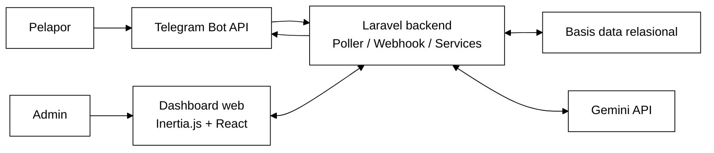

%% FIG-02 - Use Case Sistem SIRINE
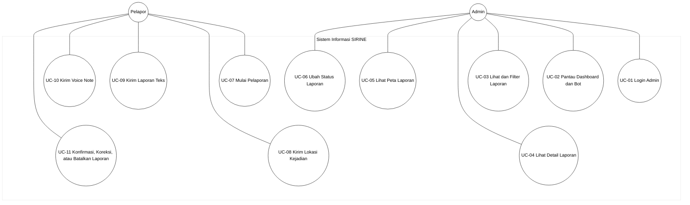

%% AD-01 - UC-01 Activity Diagram Login Admin
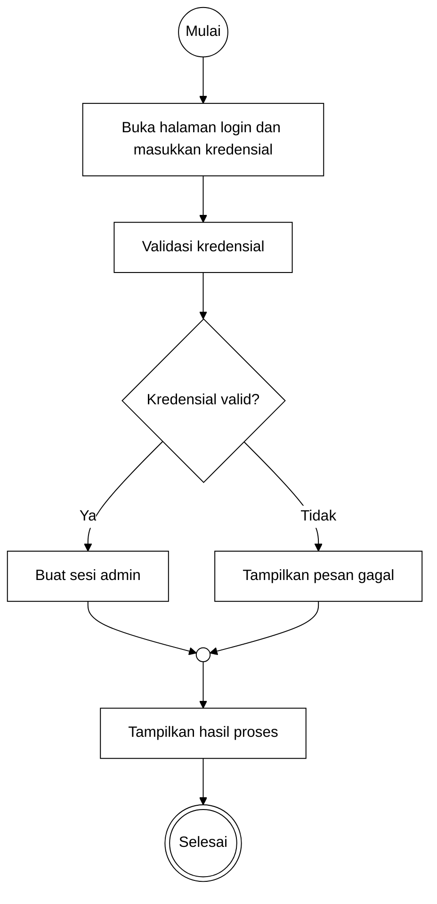

%% AD-02 - UC-02 Activity Diagram Pantau Dashboard dan Bot
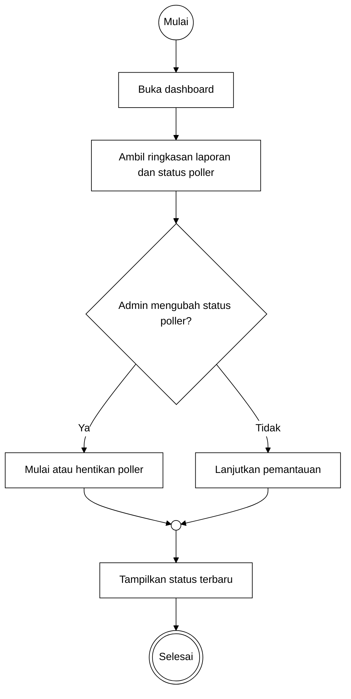

%% AD-03 - UC-03 Activity Diagram Lihat dan Filter Laporan
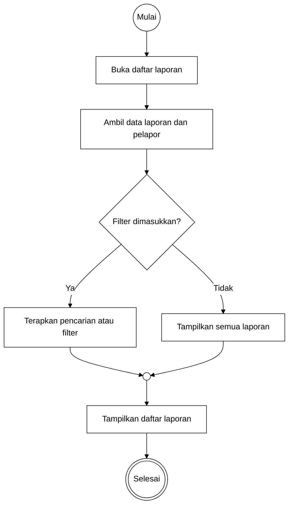

%% AD-04 - UC-04 Activity Diagram Lihat Detail Laporan
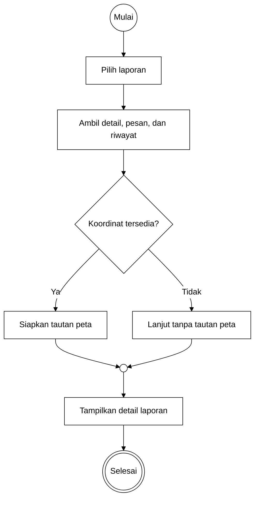

%% AD-05 - UC-05 Activity Diagram Lihat Peta Laporan
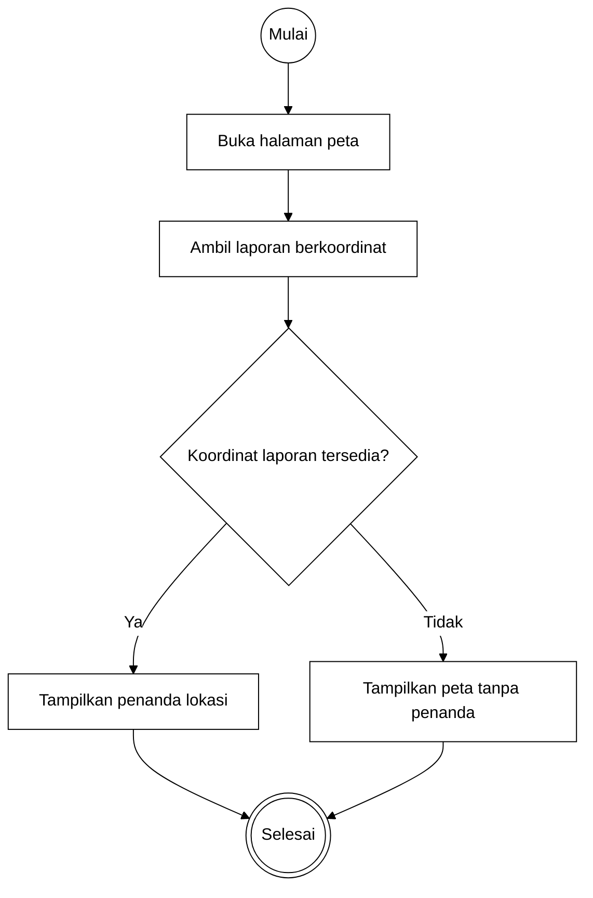

%% AD-06 - UC-06 Activity Diagram Ubah Status Laporan
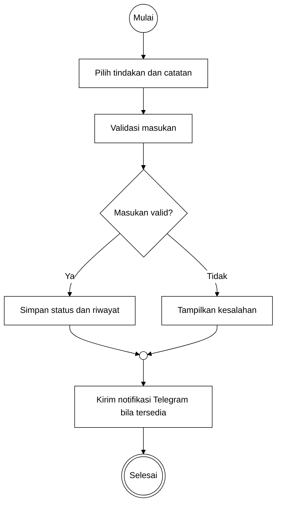

%% AD-07 - UC-07 Activity Diagram Mulai Pelaporan
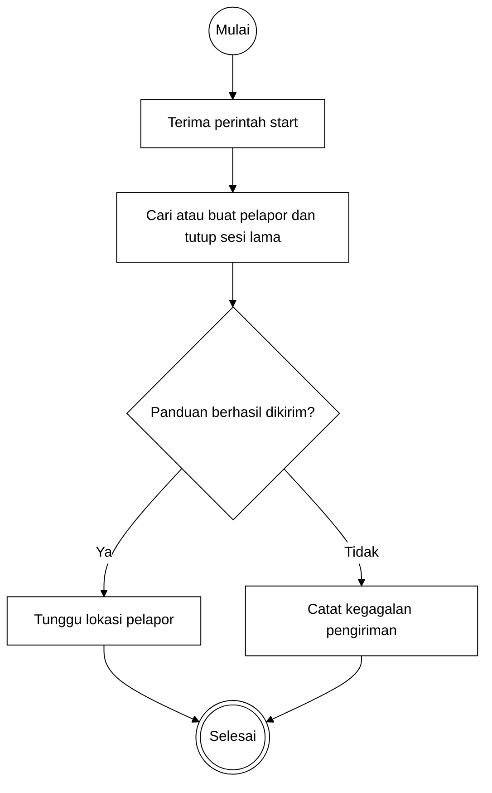

%% AD-08 - UC-08 Activity Diagram Kirim Lokasi Kejadian
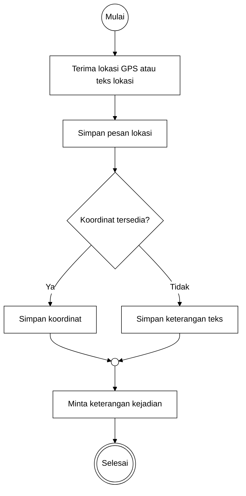

%% AD-09 - UC-09 Activity Diagram Kirim Laporan Teks
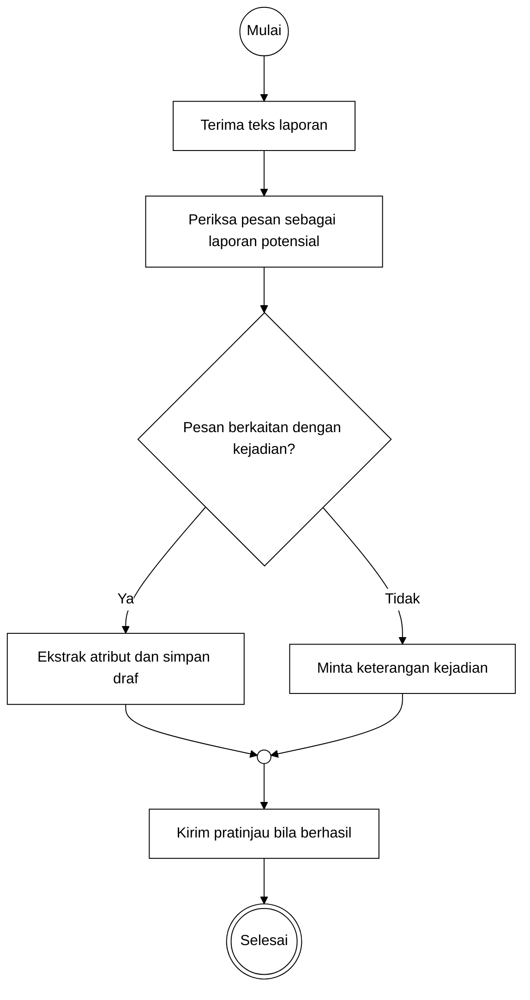

%% AD-10 - UC-10 Activity Diagram Kirim Voice Note
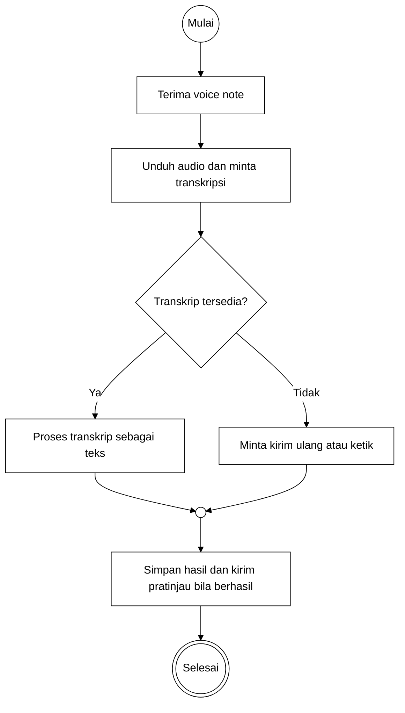

%% AD-11 - UC-11 Activity Diagram Konfirmasi, Koreksi, atau Batalkan Laporan
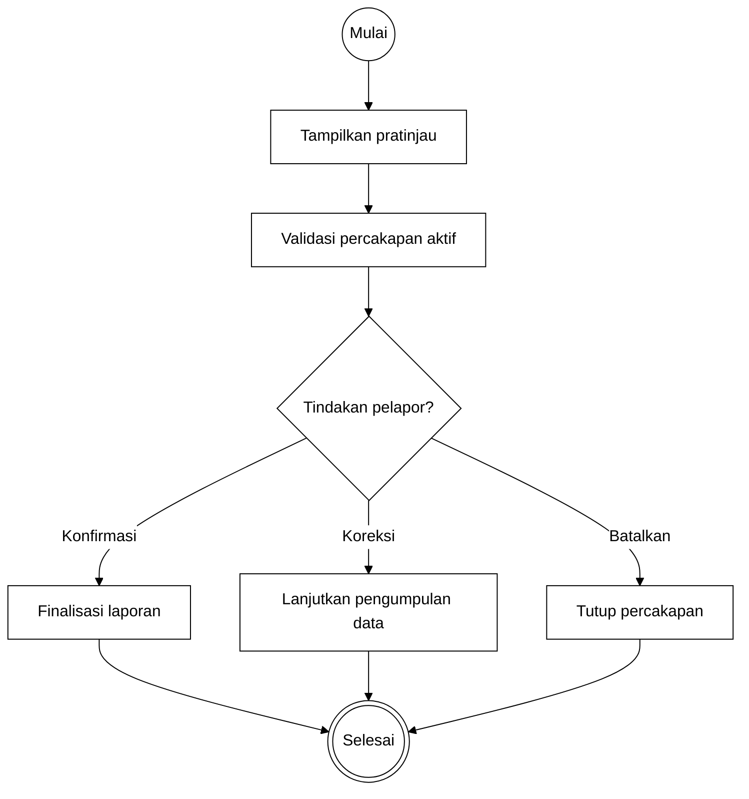

%% SD-01 - UC-01 Sequence Diagram Login Admin
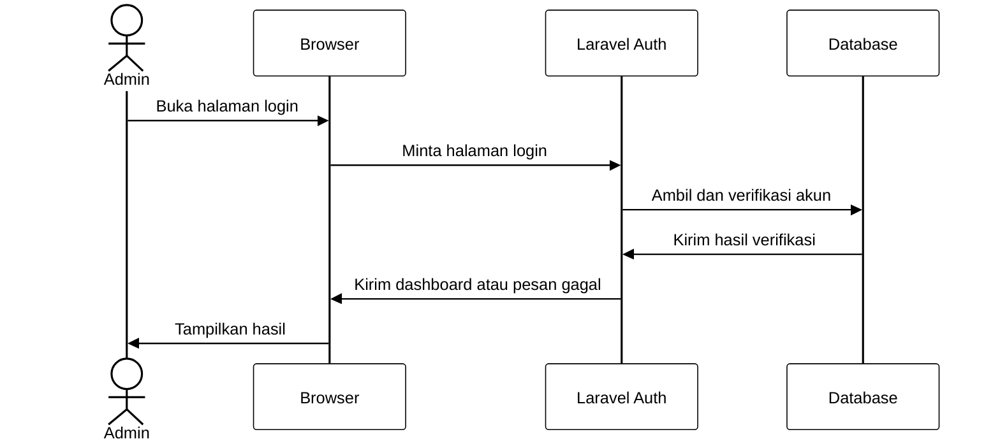

%% SD-02 - UC-02 Sequence Diagram Pantau Dashboard dan Bot
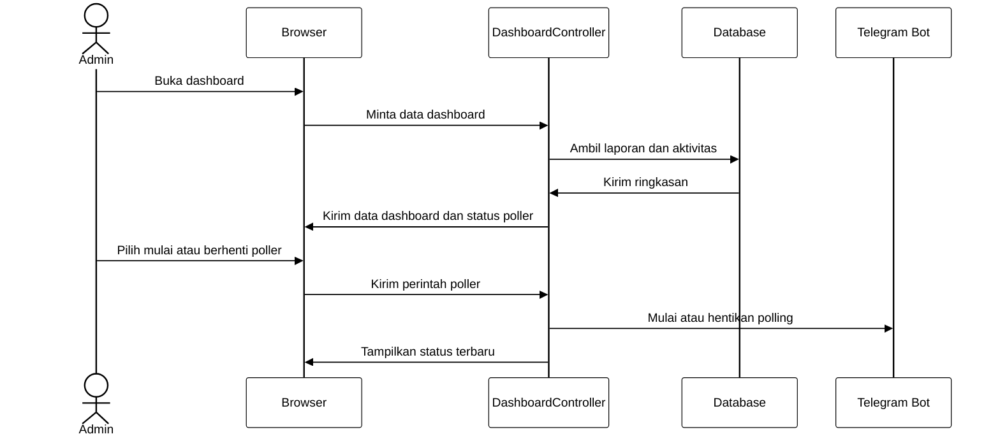

%% SD-03 - UC-03 Sequence Diagram Lihat dan Filter Laporan
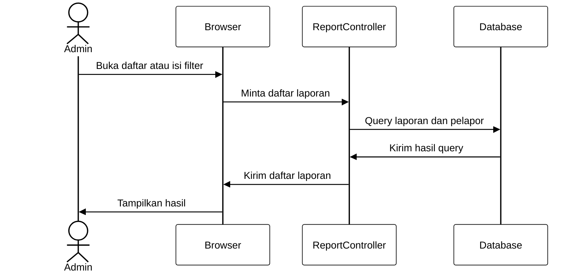

%% SD-04 - UC-04 Sequence Diagram Lihat Detail Laporan
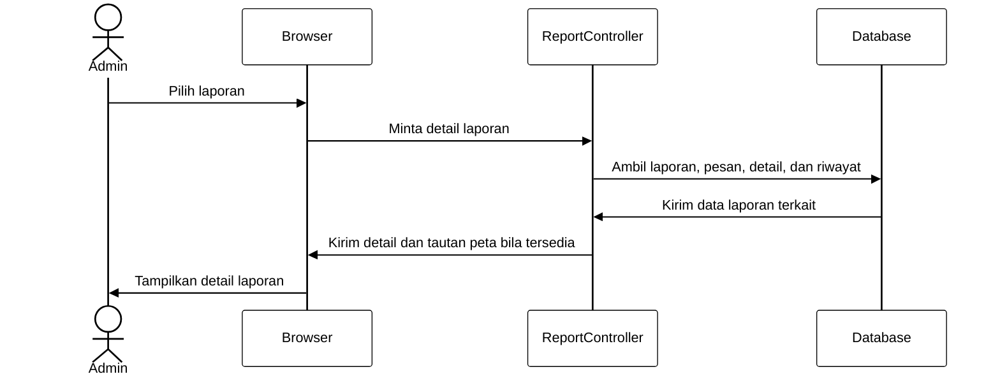

%% SD-05 - UC-05 Sequence Diagram Lihat Peta Laporan
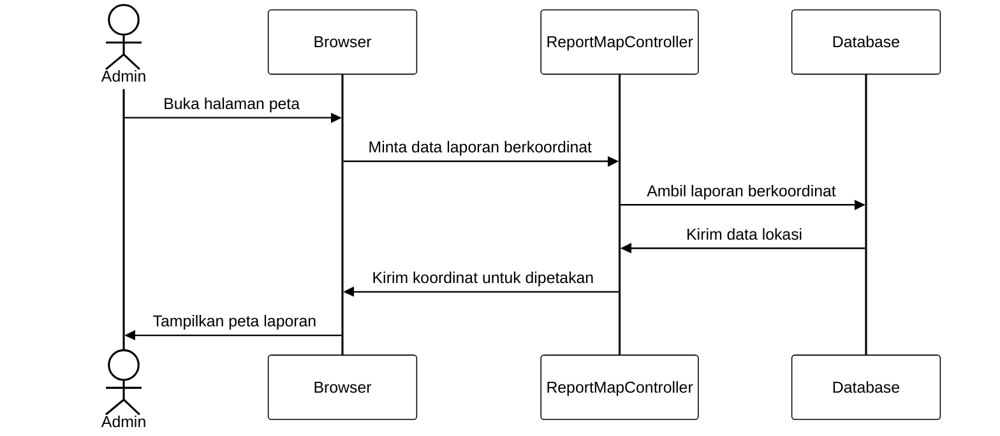

%% SD-06 - UC-06 Sequence Diagram Ubah Status Laporan
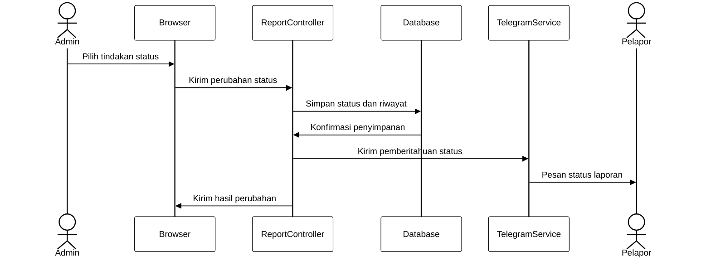

%% SD-07 - UC-07 Sequence Diagram Mulai Pelaporan
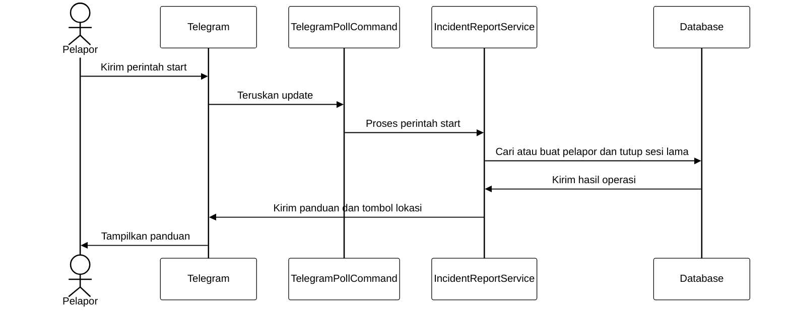

%% SD-08 - UC-08 Sequence Diagram Kirim Lokasi Kejadian
```mermaid
%%{init: {"theme":"base","themeVariables":{"primaryColor":"#ffffff","primaryTextColor":"#000000","primaryBorderColor":"#000000","lineColor":"#000000","secondaryColor":"#ffffff","tertiaryColor":"#ffffff","background":"#ffffff","mainBkg":"#ffffff","textColor":"#000000","actorBkg":"#ffffff","actorBorder":"#000000","actorTextColor":"#000000","signalColor":"#000000","signalTextColor":"#000000","labelBoxBkgColor":"#ffffff","labelBoxBorderColor":"#000000","noteBkgColor":"#ffffff","noteBorderColor":"#000000","noteTextColor":"#000000","classText":"#000000"}}}%%
sequenceDiagram
actor P as Pelapor
participant T as Telegram
participant S as IncidentReportService
participant DB as Database
    P->>T: Bagikan lokasi
    T->>S: Kirim update lokasi
    S->>DB: Simpan pesan dan koordinat
    DB->>S: Konfirmasi tersimpan
    S->>T: Minta keterangan kejadian
    T->>P: Tampilkan pertanyaan berikutnya
```

%% SD-09 - UC-09 Sequence Diagram Kirim Laporan Teks
```mermaid
%%{init: {"theme":"base","themeVariables":{"primaryColor":"#ffffff","primaryTextColor":"#000000","primaryBorderColor":"#000000","lineColor":"#000000","secondaryColor":"#ffffff","tertiaryColor":"#ffffff","background":"#ffffff","mainBkg":"#ffffff","textColor":"#000000","actorBkg":"#ffffff","actorBorder":"#000000","actorTextColor":"#000000","signalColor":"#000000","signalTextColor":"#000000","labelBoxBkgColor":"#ffffff","labelBoxBorderColor":"#000000","noteBkgColor":"#ffffff","noteBorderColor":"#000000","noteTextColor":"#000000","classText":"#000000"}}}%%
sequenceDiagram
actor P as Pelapor
participant T as Telegram
participant S as IncidentReportService
participant G as GeminiService
participant DB as Database
    P->>T: Kirim keterangan kejadian
    T->>S: Kirim update teks
    S->>G: Klasifikasi dan ekstrak informasi
    G->>S: Kembalikan atribut terstruktur
    S->>DB: Simpan pesan, draf, dan detail
    DB->>S: Konfirmasi penyimpanan
    S->>T: Kirim pratinjau
    T->>P: Tampilkan pratinjau
```

%% SD-10 - UC-10 Sequence Diagram Kirim Voice Note
```mermaid
%%{init: {"theme":"base","themeVariables":{"primaryColor":"#ffffff","primaryTextColor":"#000000","primaryBorderColor":"#000000","lineColor":"#000000","secondaryColor":"#ffffff","tertiaryColor":"#ffffff","background":"#ffffff","mainBkg":"#ffffff","textColor":"#000000","actorBkg":"#ffffff","actorBorder":"#000000","actorTextColor":"#000000","signalColor":"#000000","signalTextColor":"#000000","labelBoxBkgColor":"#ffffff","labelBoxBorderColor":"#000000","noteBkgColor":"#ffffff","noteBorderColor":"#000000","noteTextColor":"#000000","classText":"#000000"}}}%%
sequenceDiagram
actor P as Pelapor
participant T as Telegram
participant S as IncidentReportService
participant G as GeminiService
participant DB as Database
    P->>T: Kirim voice note
    T->>S: Kirim identitas file audio
    S->>T: Minta file audio
    T->>S: Kirim file audio
    S->>G: Kirim audio untuk transkripsi
    G->>S: Kirim transkrip atau kegagalan
    S->>DB: Simpan pesan dan transkrip bila tersedia
    S->>T: Kirim pratinjau atau instruksi ulang
```

%% SD-11 - UC-11 Sequence Diagram Konfirmasi, Koreksi, atau Batalkan Laporan
```mermaid
%%{init: {"theme":"base","themeVariables":{"primaryColor":"#ffffff","primaryTextColor":"#000000","primaryBorderColor":"#000000","lineColor":"#000000","secondaryColor":"#ffffff","tertiaryColor":"#ffffff","background":"#ffffff","mainBkg":"#ffffff","textColor":"#000000","actorBkg":"#ffffff","actorBorder":"#000000","actorTextColor":"#000000","signalColor":"#000000","signalTextColor":"#000000","labelBoxBkgColor":"#ffffff","labelBoxBorderColor":"#000000","noteBkgColor":"#ffffff","noteBorderColor":"#000000","noteTextColor":"#000000","classText":"#000000"}}}%%
sequenceDiagram
actor P as Pelapor
participant T as Telegram
participant S as IncidentReportService
participant DB as Database
    P->>T: Pilih konfirmasi, koreksi, atau batalkan
    T->>S: Kirim perintah
    S->>DB: Ambil dan validasi draf serta sesi
    DB->>S: Kirim keadaan percakapan
    S->>DB: Finalisasi, perbarui, atau tutup sesi
    DB->>S: Konfirmasi perubahan
    S->>T: Kirim hasil tindakan
    T->>P: Tampilkan status
```

%% FIG-25 - Class Diagram Data SIRINE
```mermaid
%%{init: {"theme":"base","themeVariables":{"primaryColor":"#ffffff","primaryTextColor":"#000000","primaryBorderColor":"#000000","lineColor":"#000000","secondaryColor":"#ffffff","tertiaryColor":"#ffffff","background":"#ffffff","mainBkg":"#ffffff","textColor":"#000000","actorBkg":"#ffffff","actorBorder":"#000000","actorTextColor":"#000000","signalColor":"#000000","signalTextColor":"#000000","labelBoxBkgColor":"#ffffff","labelBoxBorderColor":"#000000","noteBkgColor":"#ffffff","noteBorderColor":"#000000","noteTextColor":"#000000","classText":"#000000"}}}%%
classDiagram
    direction LR
    class Reporter {
        +int id
        +string name
        +string whatsapp_number
    }
    class Report {
        +int id
        +string report_code
        +int reporter_id
        +string incident_type
        +datetime incident_time
        +decimal latitude
        +decimal longitude
        +string summary
        +string report_status
    }
    class Conversation {
        +int id
        +int reporter_id
        +int report_id
        +string conversation_status
        +string current_question
        +json report_draft
    }
    class Message {
        +int id
        +int conversation_id
        +int report_id
        +string direction
        +string message_type
        +text body
        +text transcript
    }
    class ReportDetail {
        +int id
        +int report_id
        +string field_name
        +text field_value
        +int source_message_id
    }
    class ReportHistory {
        +int id
        +int report_id
        +int admin_id
        +string previous_status
        +string new_status
        +text notes
    }
    class User {
        +int id
        +string name
        +string email
    }
    Reporter "1" --> "0..*" Report : reports
    Reporter "1" --> "0..*" Conversation : conversations
    Report "1" --> "0..*" Conversation : conversations
    Conversation "1" --> "0..*" Message : messages
    Report "1" --> "0..*" Message : messages
    Report "1" --> "0..*" ReportDetail : details
    Message "0..1" --> "0..*" ReportDetail : source message
    Report "1" --> "0..*" ReportHistory : histories
    User "0..1" --> "0..*" ReportHistory : admin
```
